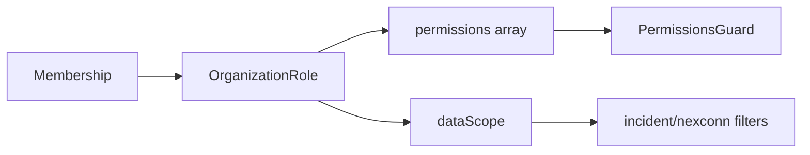

# Custom org roles with permissions

## Decision
Custom roles are **not just renamed templates**. Each org role has:

1. **Permissions** — explicit action grants from a fixed catalog (what they can do)
2. **Data scope** — `ORG` | `SITE` | `ASSIGNED` (what records they can see)
3. Optional **base template** used only to seed defaults when creating the role

System roles (Admin / Ops / Supervisor / Technician) stay seeded and immutable. Custom roles start from a template’s default permissions + scope, then the org admin can toggle permissions (and choose scope once at create).

## Permission catalog
Defined once in [`packages/shared`](packages/shared/src/index.ts) (source of truth):

- `org.settings.manage`
- `org.members.manage`
- `org.roles.manage`
- `sites.manage` / `sites.view`
- `teams.manage` / `teams.view`
- `workforce.view`
- `shifts.manage` / `shifts.view`
- `handovers.draft` / `handovers.publish` / `handovers.view`
- `incidents.create` / `incidents.assign` / `incidents.update_any` / `incidents.view`
- `analytics.view`
- `communications.view`

**Template defaults** (seeded permissions + scope):

- `ORG_ADMIN` → all permissions, scope `ORG`
- `OPERATIONS_MANAGER` → all except `org.roles.manage` / `org.members.manage` (or include members if current product allows ops to manage sites/teams only — match today’s `@Roles`), scope `ORG`
- `SUPERVISOR` → shifts/handovers/incidents create+view, sites/teams view, communications; scope `SITE`
- `TECHNICIAN` → incidents view/update assigned, shifts view, handovers view published, communications; scope `ASSIGNED`

Constraints when editing a custom role:

- Permissions must be a subset of the catalog
- Cannot grant `org.roles.manage` / `org.members.manage` unless scope is `ORG` (and only org admins can assign those)
- System roles’ permissions are read-only
- Last membership with `org.members.manage` cannot be demoted (same protection as today’s last admin)

## Data model
In [`apps/api/prisma/schema.prisma`](apps/api/prisma/schema.prisma):

- `OrganizationRole`
  - `id`, `organizationId`, `name`, `slug`
  - `baseRole` (`MemberRole`) — template used for defaults / display badge
  - `dataScope` enum: `ORG` | `SITE` | `ASSIGNED`
  - `permissions` `String[]`
  - `system` boolean
  - `@@unique([organizationId, slug])`
- `Membership.orgRoleId` (required after backfill) + keep denormalized `Membership.role` (= `baseRole`) for analytics/compat
- `Invitation.orgRoleId` + denormalized `role`
- On org create: seed four system roles with template permissions/scopes

## RBAC mechanics
- Session membership exposes `{ orgRoleId, orgRoleName, role, dataScope, permissions }`
- New `@RequirePermissions(...keys)` + `PermissionsGuard` (user must have **all** listed keys)
- Migrate current `@Roles(...)` endpoints to the matching permission(s), e.g.:
  - `@Roles('ORG_ADMIN')` on member invites → `@RequirePermissions('org.members.manage')`
  - shift create → `shifts.manage`
  - handover draft → `handovers.draft`
- Replace web `role === 'ORG_ADMIN'` / `canManage` checks with `hasPermission(session, '...')` helpers
- **Data scoping** (incidents list, nexconn channels/people): branch on `dataScope` instead of `role === 'SUPERVISOR'|'TECHNICIAN'`, keeping the same filters already implemented

Keep `@Roles` temporarily as a thin alias that maps role → default permission bundle only if needed during migration; target end state is permission checks everywhere actions are gated.

## API
- `GET/POST /organizations/current/roles`
- `PATCH/DELETE /organizations/current/roles/:id` (custom only; patch name + permissions; scope locked after create)
- Invite / update member: take `orgRoleId`; sync denormalized `role` + rely on joined org role for permissions
- Role CRUD itself requires `org.roles.manage`

## Web UI
- Settings → **Roles**: list system + custom; create custom (name, base template preset, scope, permission checkboxes grouped by area); edit custom permissions; delete if unused
- Workforce invite/role change: pick org role by name (show scope + short permission summary)
- Shell nav: gate links by permission (e.g. Settings → `org.settings.manage`, Workforce → `org.members.manage`, Shifts → `shifts.view`)
- Display `orgRoleName` in header/profile

## Out of scope
- Arbitrary new permission strings invented per org
- Changing system role permission sets
- Per-site custom roles
- Resource-level ACLs beyond existing scope filters
