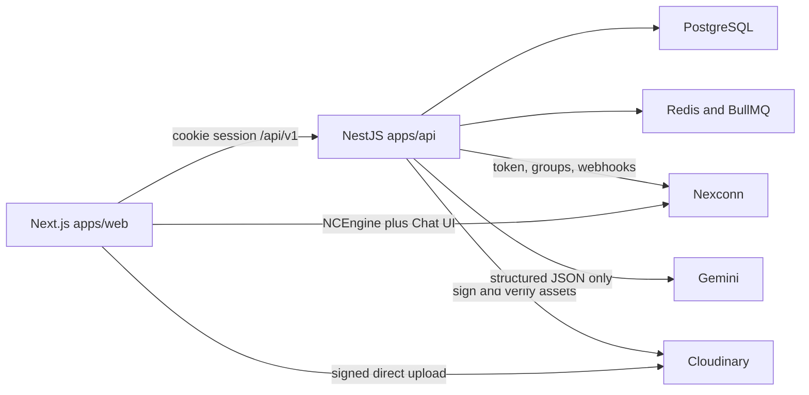

# FieldOps architecture and Phase 1

The Documents workspace has no existing app. FieldOps will live in [fieldops](c:\Users\LovinTanwar\Documents\fieldops) and will not touch the unrelated CRM file.

## Research constraints that change the design

Official docs (Nexconn chat, Chat UI 26.2.x, Platform Chat API, `@google/genai`, Cloudinary signed upload) fix these decisions:

- Pin `@nexconn/engine` and `@nexconn/chat` together, and `@nexconn/chatui` to a release whose peer range matches them. Documented compatible set is engine/chat `26.2.1` and chatui `26.2.5`. At install time, resolve `@latest` only if peers still match; do not use alpha `26.5.0-alpha.1`.
- Client lifecycle, once per authenticated session, client-only, guarded against React Strict Mode double init: `NCEngine.initialize` → register listeners → `NCEngine.connect({ token })` → `NCChatUIApplication.initialize({ hooks })` → `app.ready()` → mount `<nc-chat-ui-app-provider>`. Cleanup calls `app.destroy()`.
- Tokens come only from the Nest server: `POST https://{region-host}/v4/auth/access-token/issue` with `App-Key`, `Nonce`, `Timestamp`, and `Signature = sha1(AppSecret + Nonce + Timestamp)`. Default region host `api.sg-light-api.com`, area code `AreaCode.SG`, both overridable. App Secret never leaves the API.
- Nexconn user IDs and group channel IDs allow letters and numbers only, max 64 characters. The example `incident_INC-2026-001` is not a valid channel id. Persist the business number `INC-2026-001` and a deterministic alphanumeric channel id such as `inc2026000001`. User ids are `u` plus the UUID with hyphens removed.
- Group create is `POST /v4/group-channel/create` (`channelId`, `name`, `owner`, up to 30 `userIds`). Direct channels need no server create. Chat UI opens them with `DirectChannelIdentifier` / group identifiers after `ready()`.
- Chat media is not a Cloudinary URL. Images, files, GIFs, and voice use `Helper.createSend*MessageParams(file)` and `channel.sendMediaMessage`. Incident evidence still uploads to Cloudinary. Chat attachments follow the Nexconn upload path; the incident record stores Cloudinary metadata when the user attaches evidence to the incident itself.
- Message history for display is the client API `BaseChannel.createMessagesQuery` (page size 1–100). The documented server API has no history read (history logs are marked pending). AI summarization therefore uses `message:send` webhook metadata (id, sender, time, type, text) as an index, not a second chat product. Nexconn stays the message source of truth. Console prerequisite: enable pre-join group history so reassigned technicians can read earlier messages.
- Webhooks to subscribe: `message:send`, `message:delete`, `group_channel:operation`, `user:connection_status`. Verify `sha1(AppSecret + Nonce + Timestamp)` against `AppKey`, `Nonce`, `Timestamp`, `Signature`. Respond `2xx` within 5 seconds; enqueue work on BullMQ. Idempotency key is the event `id`. Connection status `"0"` online, `"1"` offline, `"2"` logout is presence, separate from workforce availability.
- Gemini: `@google/genai` (3.x requires Node 22), `ai.models.generateContent` with `responseMimeType: "application/json"` and `responseJsonSchema` from Zod `z.toJSONSchema()`, then `schema.safeParse`. Default model `gemini-2.5-flash`, override with `GEMINI_MODEL`. All calls stay on the API. Gemini never writes incident status.
- Cloudinary: `cloudinary.utils.api_sign_request` on the API. The browser uploads to `https://api.cloudinary.com/v1_1/{cloud}/auto/upload` with the signed folder. Folder is chosen only on the server: `fieldops/{organizationId}/incidents/{incidentId}/` and the user, team, and site equivalents. Private files use signed delivery URLs.

## System shape

- [apps/web](fieldops/apps/web): Next.js App Router, TypeScript strict, Tailwind, shadcn/ui, TanStack Query, Zustand, React Hook Form, Zod, Recharts, date-fns. Browser calls same-origin `/api/v1`, rewritten to Nest, so the session cookie stays first-party.
- [apps/api](fieldops/apps/api): NestJS modular monolith, Prisma, Pino, Swagger, BullMQ. Global prefix `api/v1`. Controllers thin; integrations behind provider classes.
- [packages/shared](fieldops/packages/shared): shared Zod schemas and role/status enums used by both apps.
- Docker Compose: PostgreSQL 16, Redis 7, API, web. Node 22. pnpm workspaces. ESLint, Prettier, Jest, Playwright added with the phases that use them.

Frontend integration folders match the spec under the web app: `apps/web/src/modules/nexconn` and media upload helpers under `apps/web/src/modules/media`. Backend modules live under `apps/api/src/modules/`: `auth`, `organizations`, `users`, `teams`, `sites`, `workforce`, `shifts`, `incidents`, `assignments`, `escalations`, `notifications`, `audit`, `nexconn`, `ai`, `ai-context`, `media`.

## Data ownership

- PostgreSQL: organizations, users, memberships, workforce, incidents, timelines, audit, channel id mappings, notification records, webhook idempotency, media metadata, context snapshots, batch summaries, assistant sessions. No binaries and no full chat replica.
- Nexconn: live messages, history roaming, presence, read state.
- Cloudinary: images, video, documents, logos.
- Redis/BullMQ: escalations, notifications, context jobs, handover, media cleanup. One queue key per incident so a stale job cannot overwrite a newer context version.
- Gemini: reasoning only. Context builder assembles a package; chat text is untrusted data inside the prompt, never instructions.

Context package is built only after org membership and incident access checks. Snapshots store version, watermark (latest incident event time plus last processed Nexconn message id), status, and source refs. Assistant threads stay private until a supervisor explicitly promotes a finding.

## Phase 1 — what we build first

Working signup, sign-in, forgot password, organization creation, invitations, role assignment, profile, and an authenticated shell. No Nexconn, Gemini, or Cloudinary calls yet. Schema includes `nexconnUserId` so later token mapping does not rewrite identity.

Auth:

- Argon2id passwords.
- Session row stores a hash of a random token. Cookie `fieldops_session` is HTTP-only, `Secure` outside local dev, `SameSite=Lax`, path `/`.
- Mutations require an allowed `Origin`. Rate-limit auth routes.
- Guards: authenticated session, active membership in the organization, role. Organization id is taken from the membership, not trusted from the body.

Phase 1 tables: `User`, `Session`, `PasswordResetToken`, `Organization`, `Membership` (role enum `ORG_ADMIN`, `OPERATIONS_MANAGER`, `SUPERVISOR`, `TECHNICIAN`), `Invitation`, `AuditLog`.

Screens, light theme, navy text, indigo accent:

- Sign up, sign in, forgot password.
- Create organization during onboarding; creator becomes org admin.
- App shell: sidebar and top bar with org name, user, role. Overview shows real membership data, not placeholder KPIs.
- Organization settings, employee directory, invite by email, assign role, edit own profile.

Seed script creates ABC Facilities Management with one admin, one operations manager, two supervisors, and six technicians. Passwords come from env and are printed only as documented dev accounts. No fake incidents or messages.

Tests: signup/login, cookie session, cross-organization read denial, role denial for invite and role change. Jest on the API. Playwright smoke: sign in and see the shell.

Docs created now and updated after each phase: `README.md`, `docs/ARCHITECTURE.md`, `docs/DEVELOPMENT_SETUP.md`, `docs/IMPLEMENTATION_STATUS.md`. The status doc is the checklist; Phase 1 is marked done only after tests pass. Stub the other required docs (`NEXCONN_INTEGRATION`, `GEMINI_INTEGRATION`, `AI_CONTEXT_MANAGEMENT`, `CLOUDINARY_INTEGRATION`, `API_REFERENCE`, `DEPLOYMENT`) with the decisions above and a “not implemented” banner so later phases fill them instead of inventing a second design.

`.env.example` includes empty `NEXCONN_*`, `GEMINI_*`, and `CLOUDINARY_*` keys so later phases do not reshuffle config.

## Phases 2–8 (after Phase 1 is verified)

- Phase 2: install `npx skills add https://github.com/NexConnAI-Dev/nexconn-skills.git --skill nexconn-chat`, then `apps/web/src/modules/nexconn` (provider, engine, Chat UI, connection, channels, presence, messages, events). `POST /api/v1/nexconn/token` for the signed-in user only. `POST /api/v1/nexconn/webhooks` with signature check, idempotency, BullMQ. Exit: two browsers exchange a real group or direct message through Chat UI.
- Phase 3: `media` module, signed uploads, metadata persistence, signed delivery, cleanup job, Nexconn media messages via `Helper` for chat and Cloudinary for incident evidence.
- Phase 4: teams, sites, skills, availability (separate from Nexconn presence), shifts. Seed Mumbai, Pune, Nashik and the three maintenance teams.
- Phase 5: incidents, assignment workflow `OPEN → ASSIGNED → ACCEPTED → IN_PROGRESS → RESOLVED → CLOSED`, resolution notes required, timeline, idempotent group provisioning (`incident` channel mapping, pending setup if Nexconn fails), membership updates without a new channel on reassignment, three-pane incident workspace with the real Chat UI in the center.
- Phase 6: `ai` and `ai-context` modules. Classification suggestions require user approval. Summaries, troubleshooting, and handover run on BullMQ. Three-level memory: long-term snapshot, batch summaries, recent messages from the webhook index plus client history for the open workspace. Versioned snapshots, freshness, tenant checks, private assistant sessions. Gemini failure never blocks incident CRUD.
- Phase 7: dashboard KPIs from PostgreSQL, live feed from domain events, escalations (critical immediate, high 15 minutes, medium 30 minutes, configurable), notifications with dedupe, analytics.
- Phase 8: responsive technician flows, Playwright E2E against real dev credentials, security pass, deployment doc. Mock Nexconn, Gemini, and Cloudinary only inside unit tests.

Each phase updates `docs/IMPLEMENTATION_STATUS.md` and is not called complete until its tests pass.