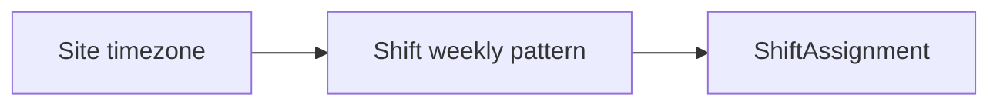

# Recurring weekly shifts

## Problem
Today a shift is a single dated window (`startsAt` / `endsAt` datetimes) in [`Shift`](apps/api/prisma/schema.prisma) and [`createShiftSchema`](packages/shared/src/operations.ts). That forces picking calendar dates for something that should be “Day shift, Mon–Fri, 08:00–16:00”.

Nexconn RBAC and handovers only need shift *identity* + assignments, not calendar instances — so moving to weekly patterns is safe for those call sites.

## Model (chosen)
Treat each `Shift` as a **recurring weekly template** tied to a site:

- `daysOfWeek`: `Int[]` — `1=Mon … 7=Sun` (ISO weekday)
- `startTime` / `endTime`: `String` — `"HH:mm"` in the **site timezone**
- Overnight allowed when `endTime <= startTime` (e.g. 22:00–06:00)
- Drop `startsAt` / `endsAt`

Example: Day shift Mon–Fri 08:00–16:00 → `{ daysOfWeek: [1,2,3,4,5], startTime: "08:00", endTime: "16:00" }`.

No separate “generate dated instances” table for now — one shift row = the weekly pattern + supervisor + assignees.

## Changes

### 1. Prisma + migration
In [`apps/api/prisma/schema.prisma`](apps/api/prisma/schema.prisma):

- Remove `startsAt`, `endsAt`
- Add `daysOfWeek Int[]`, `startTime String`, `endTime String`
- Replace index `@@index([organizationId, startsAt])` with `@@index([organizationId, siteId])`

Migration: map any existing rows by deriving weekday(s) + local times from old datetimes where possible; otherwise leave empty arrays / `"00:00"` and rely on re-create in UI (seed/demo data).

### 2. Shared validation
Update [`packages/shared/src/operations.ts`](packages/shared/src/operations.ts) `createShiftSchema`:

- `daysOfWeek`: non-empty array of ints `1..7`, unique
- `startTime` / `endTime`: match `/^\d{2}:\d{2}$/` with valid hours/minutes
- Keep `siteId`, `name`, `supervisorId`, `memberIds`

Rebuild `@fieldops/shared` so API/web pick up the type.

### 3. API create/list
In [`workforce.service.ts`](apps/api/src/modules/workforce/workforce.service.ts) `createShift`:

- Validate days + times (no “end after start” datetime check; allow overnight)
- Persist new fields instead of `Date` parsing

List already returns full shift rows — new fields flow through automatically.

### 4. Shifts UI
In [`apps/web/src/app/app/shifts/page.tsx`](apps/web/src/app/app/shifts/page.tsx):

- Replace datetime-local inputs with:
  - Day toggles (Mon–Sun), with presets **Mon–Fri** and **Mon–Sat**
  - Two `type="time"` inputs (start / end)
- Table “Window” column: e.g. `Mon–Fri · 08:00–16:00` (compact day range formatting)

## Out of scope
- Calendar instances / exceptions (PTO, holidays)
- Auto-generating dated shift channels per day
- Changing handover publish/notify behavior
